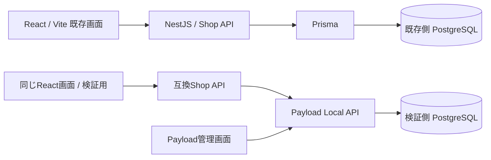

# 既存バックエンドとPayload検証環境

このデモは、本番を想定した既存システムと、Figmaで画面・仕様を検証するための環境を分けています。実際の商用本番環境ではありません。



両方のShop APIは商品ID・DTO・検索条件・送料・在庫上限・認証方法を共有します。DB・Cookie・Payload管理者は分離しています。片方の商品やカートを書き換えても、もう片方には反映されません。共通seedは架空データのみです。

## 初回起動

必要なもの: Docker Desktop（起動済み）、Git、初期化用のNode.js。コンテナ内はNode 24、PostgreSQL 17です。ローカルでバックエンド開発・全テストを実行する場合はNode **24.22.1以降**を使います。

```sh
node scripts/init-docker.mjs
docker compose --env-file .env.docker --profile payload up -d --build
```

初回ビルド後、マイグレーション→seed→API→Webの順で起動します。起動時seedは既存の商品編集やカートを上書きしません。

| 用途 | URL |
| --- | --- |
| 既存React + NestJS + Prisma | http://localhost:8080 |
| 検証React + Payload | http://localhost:8081 |
| Payload管理画面 | http://localhost:3002/admin |
| NestJSヘルスチェック | http://localhost:3001/api/health |
| Payload互換APIヘルスチェック | http://localhost:3002/shop-api/health |

既存側だけ起動: `docker compose --env-file .env.docker up -d --build`

Payload側だけ起動: `docker compose --env-file .env.docker --profile payload up -d --build payload-web`

両方の画面は同じReactビルドです。Nginxが `/api/` をNestJSの `/api/` またはPayload側の `/shop-api/` に転送します。Payloadの標準 `/api/products` へフロントを直接つなぎ替える構成ではありません。

## ログイン

初期化で生成される `.env.docker` にローカル専用のランダムな認証情報があります。Git・Dockerイメージ・配布ZIPには含めません。このファイルをローカルのエディタで確認してください。

- ショップ会員: `alice@example.test` / `bob@example.test`、パスワードは `DEMO_PASSWORD`。
- Payload管理者: `PAYLOAD_ADMIN_EMAIL` / `PAYLOAD_ADMIN_PASSWORD`。会員とは別の認証。
- ゲストでも商品・カートを操作できます。会員にログインすると会員自身のカートに切り替わります。ゲストカートの自動統合はありません。
- パスワードの環境変数を変更しても、既存ユーザーのパスワードは自動更新されません。会員は下記seedリセット、管理者は管理画面で変更します。

セッションはランダムトークンのハッシュだけをDBに保存し、8時間で失効します。CookieはHttpOnly・SameSite=Lax。ローカルHTTP用にSecureは無効です。HTTPS環境では両APIに `SECURE_COOKIES=true` を指定してください。

## 保存・リセット・停止

```sh
# 停止してもDBボリュームは保持
docker compose --env-file .env.docker --profile payload down
# 再開
docker compose --env-file .env.docker --profile payload up -d
# 既存側の商品・会員・セッション・カートだけを初期化
docker compose --env-file .env.docker exec native-api npm run seed -- --reset
# Payload側の商品・会員・セッション・カートだけを初期化（管理者は保持）
docker compose --env-file .env.docker --profile payload exec payload-api npm run seed -- --reset
```

リセットはその環境の検証データを削除します。`down -v` は両DBの全データ・管理者も消すため、通常の停止には使いません。リセット後はブラウザを再読み込みしてください。

## ソースと拡張

| 場所 | 役割 |
| --- | --- |
| `backend/shared/shop.mjs` | 認証・DTO・検索・在庫・価格・送料の共通ルール |
| `backend/nest` | NestJS HTTP入口、Prismaモデル、コミット済みSQL migration |
| `backend/payload` | Payloadコレクション・管理画面・Local APIアダプター・migration |
| `docs/seed-*.json` | 両環境の共通初期データ |
| `src/api/client.ts` | React側のHTTP境界 |
| `compose.yaml`, `docker/` | 独立DBと同じフロントの起動構成 |

Payloadには `externalId` と標準の内部IDを持たせ、互換APIではexternalIdを返します。商品画像はフロントの `public/products` を使用します。Payloadではcategoryも外部ID文字列として保持し、管理画面からの参照整合性までは保証しません。企業の実データを扱う場合はrelationship・mediaコレクションへの置き換えが必要です。

比較・お気に入り・お問い合わせは未実装です。追加時は先にAPI契約を定義し、Payload側で検証してからNestJS/Prisma側へ同じ契約を実装します。UIは接続先に依存しない状態を維持します。

## Figmaデモでの扱い

1. 既存側を「現状のサイト」として提示します。
2. 同じ架空データを持つPayload側を検証用に使い、管理画面で在庫などを変更します。
3. Specs/GuidelinesでAPI契約・画面要件・DS利用条件を共有します。
4. 機能追加を検証した後に既存側へ実装を戻す流れを示します。

ここまでの検証はローカルDocker環境です。**Figma Code Layers/Makeからの実接続・インポートは未検証**です。クラウドのFigma実行環境からlocalhostへ直接アクセスできるとは限りません。外部デモ用のHTTPSホスト、許可origin、Cookieの扱いを接続方式に合わせて別途設定します。管理者資格情報はフロントへ渡しません。既存Sitesの公開デモはMSWモック版のままです。

## 適用範囲

商品数8件のデモとして、全商品を取得してアプリ内で検索します。大量データ向けDB検索、決済、注文、在庫予約、会員登録、パスワード再設定、メール配送、SSO、本番監視・バックアップは含みません。ログイン制限はプロセスメモリ内で、分散環境用のものではありません。期限切れセッション・ゲストの定期削除も本番化時に追加します。

Payload標準APIは管理者専用です。Shop APIだけが必要な商品情報を公開します。APIキー不要、DBポート非公開、Web/APIのホスト公開は127.0.0.1に限定しています。

## 再検証

```sh
npm ci
npm test
npm run test:e2e
node --env-file=.env.docker --test backend/tests/contract.test.mjs
RESTART_TEST=1 node --env-file=.env.docker --test backend/tests/contract.test.mjs
node --env-file=.env.docker node_modules/@playwright/test/cli.js test -c playwright.backend.config.ts
```

実APIテストはAlice/Bobのカートを変更・消去します。再起動テストはこのComposeのAPIとDBを再起動するので、デモ操作中には実行しないでください。
